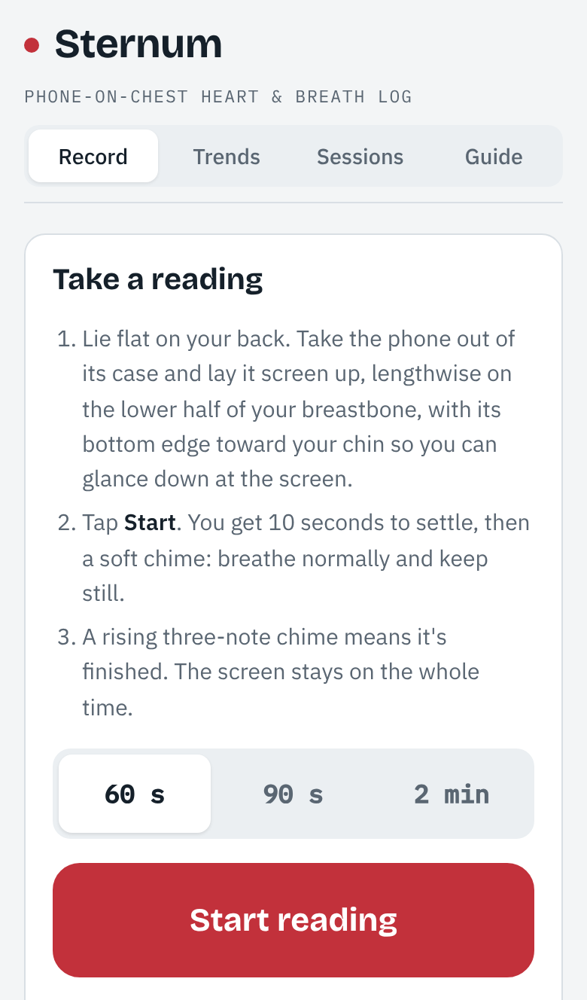
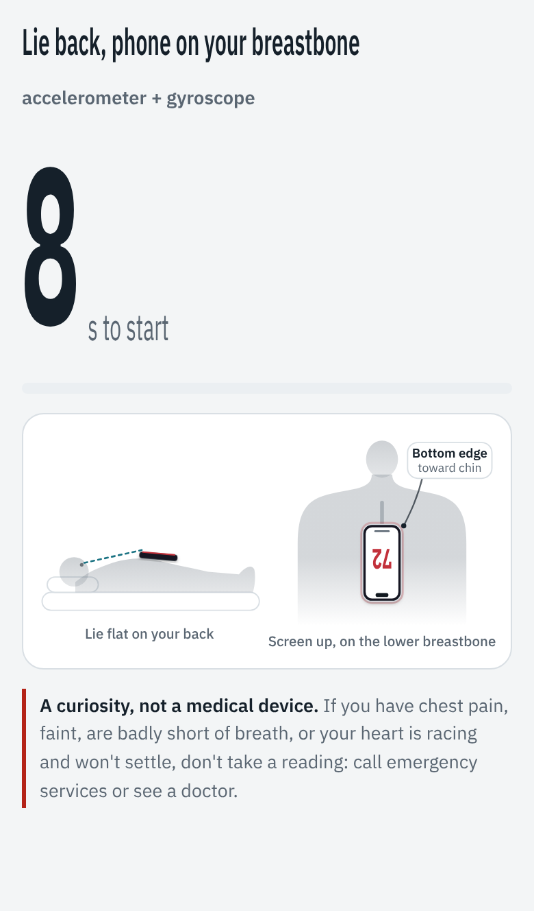
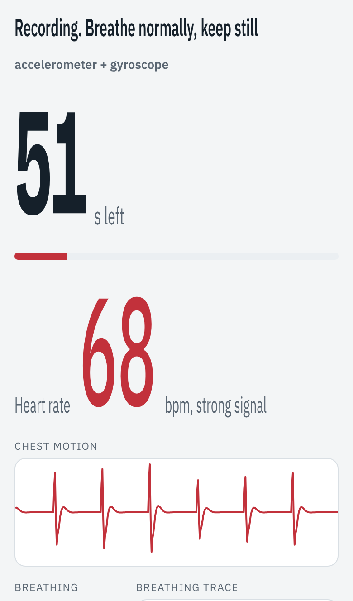
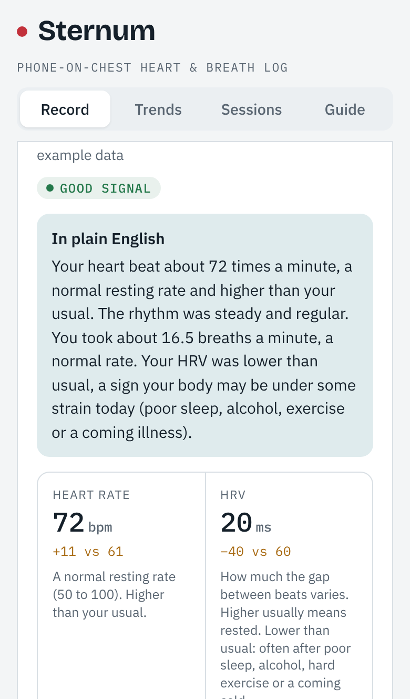
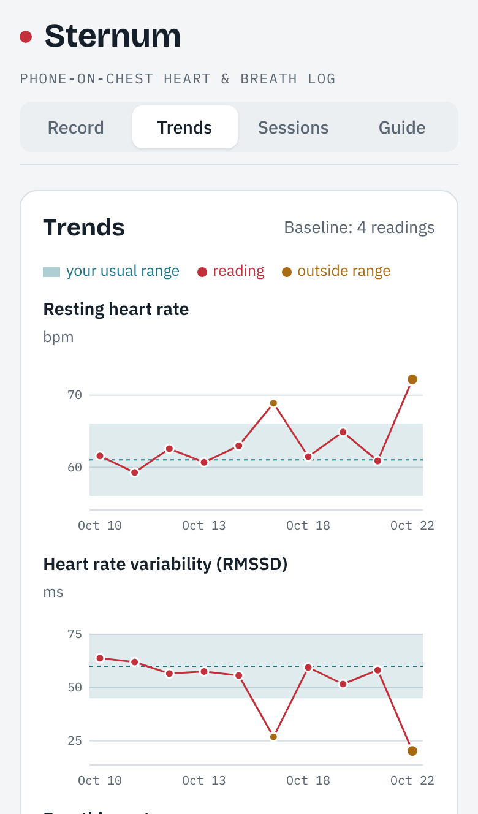

# Sternum

**Lie down, rest your phone on your chest for a minute, and read your heart.**

Sternum is a web app that turns a phone's motion sensors into a heart and breathing log. Each heartbeat gives your chest a tiny jolt and rock, and each breath tilts the phone slightly. Sternum picks those up and shows heart rate, heart rate variability, breathing rate and rhythm, explained in plain English and compared with your own baseline.

**Try it on your phone: [sternum-chi.vercel.app](https://sternum-chi.vercel.app)** (open it on a computer and you get a QR code to scan).

<p>
  
  
  
  
  
</p>

> **A curiosity, not a medical device.** Sternum is a personal experiment. It has been tested on one person and on simulated data, it can be wrong, and it cannot rule anything out. If you have chest pain, faint, are badly short of breath, or your heart is racing and won't settle, don't take a reading: call emergency services or see a doctor.

## What you need

- A phone with motion sensors: an iPhone (Safari) or an Android phone (Chrome).
- A bed, and about two minutes: rest for one, record for one.
- The phone out of its case, lying screen up and lengthwise on the lower half of your breastbone, with its bottom edge toward your chin so you can glance down at the screen.

## What you get

- Heart rate and beat-to-beat intervals, from seismo- and gyrocardiography (the accelerometer and gyroscope).
- Heart rate variability: RMSSD, SDNN and pNN50.
- Breathing rate, regularity and pauses, from chest tilt.
- Breath-linked heart rate swing (respiratory sinus arrhythmia).
- A rhythm check: extra beats, long gaps, and a random-rhythm test for atrial-fibrillation-like patterns (Dash et al. 2009), with a Poincaré plot.
- An averaged heartbeat waveform, compared with your baseline.

Each reading is compared with your own baseline (mean ± 2 SD of readings you mark as baseline) and flagged in plain language. These are wellness flags, not a diagnosis.

## Talk it through with Claude

**Sessions → Save file** exports one JSON file with your readings, optionally with raw sensor data for the last three. The file carries its own field guide, explaining every number, how it's measured and what the app flags. So you can attach it to any Claude chat and ask "what do my readings say?" without explaining anything first.

## Privacy

There is no account, server or upload. Readings are computed and stored in the browser: summaries in localStorage, raw motion data from the last 10 readings in IndexedDB. Sternum only uses the motion sensors. It never turns on the microphone or camera, and it makes no requests to other sites (fonts are self-hosted). After the first visit it works offline. The only way data leaves the phone is a file you save or share yourself.

Add it to the Home Screen. Safari deletes a website's data if you don't visit for 7 days, but a Home Screen app keeps it.

## How a reading works

Tap **Start reading** and allow motion access. You get a 10-second countdown to settle, showing where the phone goes. Then a chime, and the recording (60 s, 90 s or 2 min) with a live pulse, chest motion and breathing view. The countdown and heart rate are drawn tall and narrow, so they stay legible when you glance down the phone from your chin. A rising three-note chime means it's done, and the screen stays awake throughout.

## Developing

No build step is needed on the host: `index.html` is committed. On Vercel, import the repo with framework preset "Other" and no build command.

```
npm run bundle  # inlines src/ into index.html (not "build", so Vercel serves the repo as is)
npm test        # runs the analysis on simulated recordings and checks the results
```

CI runs the tests and checks that `index.html` matches `src/`.

- `src/analysis.js`: signal processing (pure functions, also runs in Node)
- `src/page.html`: the page (styles, UI, live recording, storage, sharing)
- `build.js`: inlines the analysis, the keep-awake video and the example readings into `index.html`
- `sw.js`: offline cache for the app shell
- `test/test.js`: checks heart rate, breathing, HRV and rhythm flags on simulated recordings
- `fonts/`: self-hosted Bricolage Grotesque and IBM Plex (SIL Open Font License)
- `vendor/`: NoSleep.js keep-awake video (MIT), and the QR code generator by Kazuhiko Arase (MIT), loaded only on computers
- `icons/`: `icon.svg` is the source; the PNGs are rendered from it

### Known limits

- Accuracy hasn't been checked against an ECG. Wearing an Apple Watch or chest strap during a few readings and comparing beat times is the next step.
- On simulated recordings with a noisier accelerometer, motion-only beat detection starts to slip (the test run prints how often). Real readings so far have been clean, but a noisy phone or a restless reading may be less reliable.

## Licence

MIT, see `LICENSE`. Third-party pieces keep their own licences, listed above.
